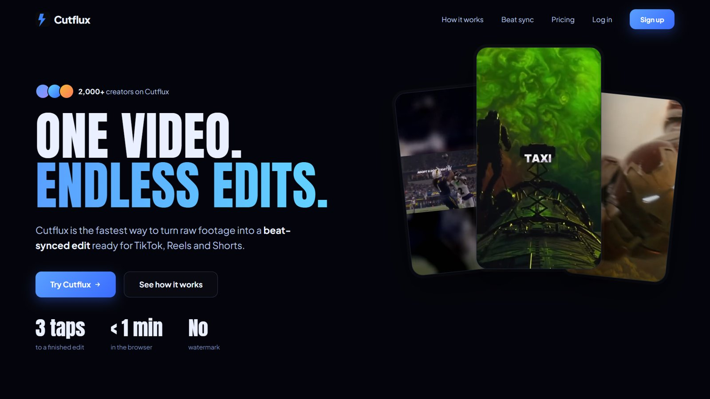
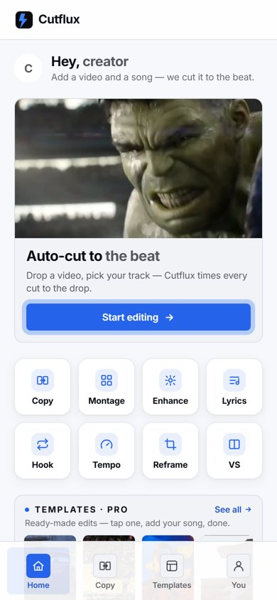
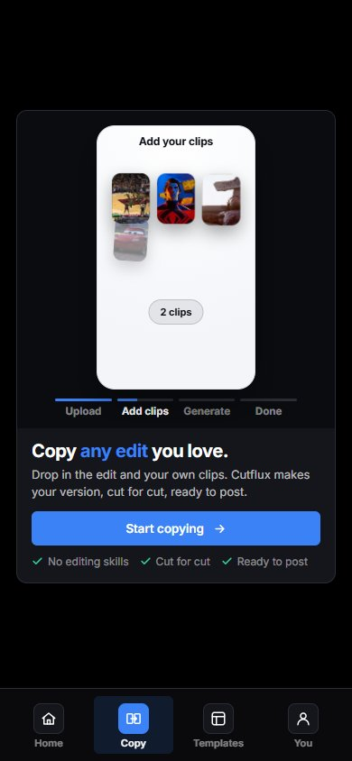
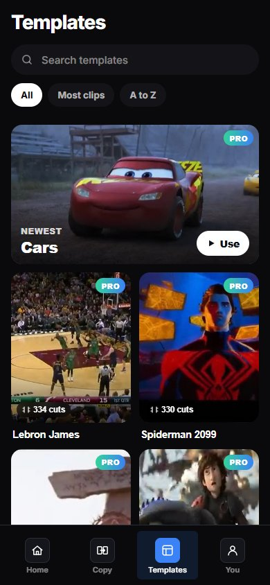
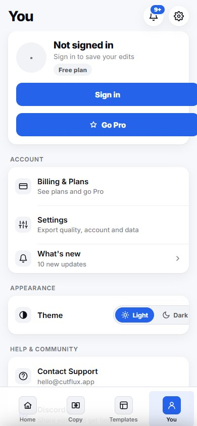
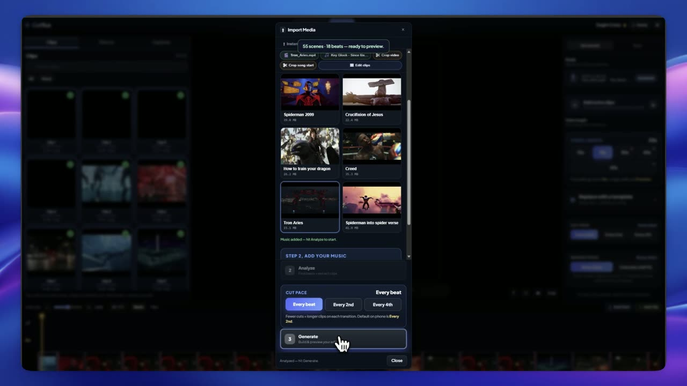

# Cutflux: beat-synced video editing, on the web and iOS

**Live:** [cutflux.app](https://cutflux.app)  ·  **Built and run by:** Dagim Cross ([@for-he-s-loved](https://github.com/for-he-s-loved))

Also on the [App Store](https://apps.apple.com/us/app/cutflux/id6794893652). Cutflux turns raw clips and a song into an edit where every cut lands on the beat. I designed, built, shipped and maintain it on my own. The source code is private. I'm happy to walk through it in an interview.

  

  
  
  
  

## What it does

- **Create Edits:** drop in clips and a song, and Cutflux cuts them to the beat. A timeline lets you fine-tune every cut with a live preview.
- **Copy an Edit:** show it an edit you like, and it recuts your own footage with the same cuts and pacing.
- **Templates, captions, sound effects and transitions:** ready-made templates, animated captions, sound effects on every hit, and transitions that look the same in the preview and the final video.
- **More tools:** Lyric Punch, Hook Loop, Tempo Ramp, Smart Reframe, Photo Montage, Photo Enhance and VS Maker.
- **Everywhere:** desktop web, mobile web with light and dark themes, and an iOS app on the App Store.
- **A real business:** accounts, paid subscriptions, invite codes, and a separate staging site for testing before every release.

## Built for AI agents

- **Agent tools (MCP):** Cutflux exposes its editing engine as tools an AI assistant can call. Claude can plan an edit, cut it to the beat, add captions and render it, entirely on request.
- **AI inside the product:** song lyrics are transcribed automatically into timed karaoke captions, and Copy an Edit learns an edit's cuts and pacing from a single reference video.
- **Built with AI coding agents:** I develop Cutflux with AI coding agents that I direct and review, with staging-first deploys and real-data checks before anything reaches users. I can even give it a task with a phone call.

## Results

| What I improved | Before | After |
|---|---|---|
| Time to generate an edit | about 41 seconds | about 0.2 seconds |
| Smoothness of copy-edit renders | 5.7 frames per second | 27.3 frames per second |
| Preview of very high-resolution (8K) footage | about 8.7 frames per second | smooth on phones and laptops |
| Size of burned-in captions | 26% smaller than the preview | matches the preview |
| Broken exports (black or cut-short videos) | could reach users unnoticed | caught before they ship |

## How I work

- **Staging first:** every change goes to a staging site before production, with a rollback ready.
- **Real media:** I test on real phone footage and real songs, which caught bugs synthetic test clips missed.
- **Measured:** I measure speed and smoothness before and after every change.
- **Accessible:** readable text sizes, strong contrast in both themes, and motion that respects reduced-motion settings.

## More apps by me

- [**Playbook Schedule**](https://apps.apple.com/us/app/playbook-schedule/id6756199275): a team hub for coaches and athletes. Snap a photo of a schedule to turn it into calendar events, plus RSVPs, team chats and calendar sync.
- [**The Lore app**](https://apps.apple.com/us/app/the-lore-app/id6756676179): self-improvement as a game, with daily challenges, streaks and progress tracking.

---

© Dagim Cross. All rights reserved. See [LICENSE](LICENSE).
